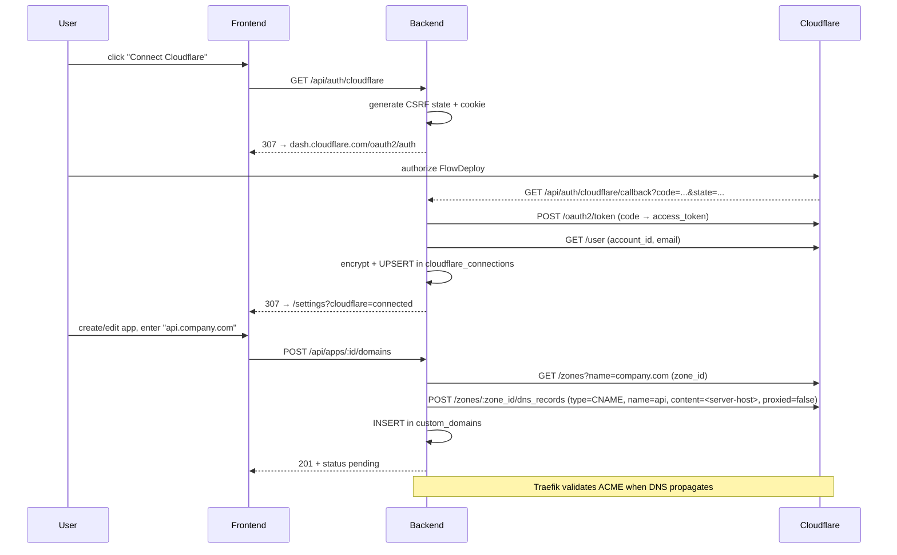

# Automatic DNS via Cloudflare (OAuth)

FlowDeploy lets each user connect their own Cloudflare account and automate subdomain (CNAME) registration for apps. This document describes the end-to-end flow, configuration surface, and troubleshooting.

> Components involved:
>
> - `apps/backend/internal/cloudflare/client.go` — Cloudflare API HTTP client
> - `apps/backend/internal/handler/cloudflare_auth_handler.go` — OAuth flow + status
> - `apps/backend/internal/handler/domain_handler.go` — per-app domain CRUD
> - Migration `000007_cloudflare_domains` — `cloudflare_connections` and `custom_domains` tables

## 1. Overview

Goal:

1. User connects Cloudflare via OAuth (same UX as GitHub).
2. User enters the domain for the app (`api.company.com`).
3. Backend automatically creates the CNAME in the user's Cloudflare zone, pointing to the FlowDeploy server.
4. The app is reachable on that domain once DNS propagates and Traefik issues the Let's Encrypt certificate.

## 2. OAuth flow + DNS creation



## 3. Data model

### `cloudflare_connections`

One connection per user (UNIQUE on `user_id`).

| Column                    | Description                                        |
| ------------------------- | -------------------------------------------------- |
| `id`                      | UUID                                               |
| `user_id`                 | FK → `users` (ON DELETE CASCADE)                   |
| `cloudflare_account_id`   | id returned by Cloudflare API                      |
| `cloudflare_email`        | account owner email                                |
| `access_token_encrypted`  | AES-encrypted token via `internal/crypto`          |
| `refresh_token_encrypted` | refresh token (when applicable)                    |
| `token_expires_at`        | token expiry (nullable)                            |

### `custom_domains`

One row per (app, domain).

| Column           | Description                                        |
| ---------------- | -------------------------------------------------- |
| `id`             | UUID                                               |
| `app_id`         | FK → `apps` (ON DELETE CASCADE)                    |
| `domain`         | UNIQUE                                             |
| `zone_id`        | Cloudflare zone id                                 |
| `dns_record_id`  | Cloudflare record id (for update/delete)           |
| `record_type`    | default `CNAME`                                    |
| `status`         | `active`, `pending`, `error` (updated by backend) |

## 4. Environment configuration

Add to backend `.env`:

```bash
# Cloudflare OAuth (create OAuth Application at https://dash.cloudflare.com/)
CLOUDFLARE_OAUTH_CLIENT_ID=<client_id>
CLOUDFLARE_OAUTH_CLIENT_SECRET=<client_secret>
CLOUDFLARE_OAUTH_CALLBACK_URL=https://<deploy-host>/api/auth/cloudflare/callback

# FlowDeploy public hostname (CNAME target)
BACKEND_PUBLIC_HOST=deploy.example.com
```

> Without these variables the handler still registers routes, but any OAuth attempt returns `503` with `cloudflare_oauth_disabled`.

## 5. Endpoints

| Method | Endpoint                                  | Description                                        |
| ------ | ----------------------------------------- | -------------------------------------------------- |
| `GET`  | `/api/auth/cloudflare`                    | Start OAuth (generate state, redirect)             |
| `GET`  | `/api/auth/cloudflare/callback`           | Receive `code`, exchange token, save connection    |
| `POST` | `/api/auth/cloudflare/connect`            | Connect with **API Token** (OAuth alternative)     |
| `POST` | `/api/auth/cloudflare/disconnect`         | Remove user connection                             |
| `GET`  | `/api/auth/cloudflare/status`             | Show active connection and metadata                |
| `GET`  | `/api/apps/:id/domains`                   | List app domains                                   |
| `POST` | `/api/apps/:id/domains`                   | Create automatic CNAME                             |
| `DELETE` | `/api/apps/:id/domains/:domainId`        | Remove Cloudflare CNAME and table row              |

The **API Token** alternative (`/connect`) is useful for users who prefer not to use OAuth (e.g. Cloudflare for Teams). The token needs minimal permissions: `Zone.DNS:Edit`, `Zone.Zone:Read`.

## 6. API Token connection (no OAuth)

```http
POST /api/auth/cloudflare/connect
Content-Type: application/json

{
  "apiToken": "<cloudflare-api-token>",
  "email": "ops@company.com"
}
```

The backend validates the token via `GET /user/tokens/verify` before persisting, and stores it encrypted like the OAuth flow.

## 7. Zone resolution

When a domain is created, the backend resolves the zone automatically:

1. Split the domain into suffixes (`api.company.com` → `company.com`, `com`).
2. For each suffix, call `GET /zones?name=<suffix>` on the user's account.
3. Use the first zone found. If none match, return `cloudflare_zone_not_found` for the frontend.

## 8. Record type

- By default, records are **CNAME** pointing to `BACKEND_PUBLIC_HOST`.
- For apex (`company.com`), the backend creates an **A** record to the backend IP (Cloudflare allows CNAME flattening on DNSSEC zones, but we prefer `A` to avoid surprises).
- `proxied` is always `false` so Let's Encrypt via Traefik is not interfered with.

## 9. Domain lifecycle

```
created  ──►  CNAME created in Cloudflare
              │
              ▼
pending  ──►  waiting for DNS propagation + ACME
              │
              ▼
active   ──►  Traefik serving TLS for the domain
```

The `status` column is updated by domain health checks (DNS resolution + TLS handshake). Persistent failure becomes `error` and shows in the panel.

## 10. Removal

`DELETE /api/apps/:id/domains/:domainId`:

1. Calls `DELETE /zones/:zone_id/dns_records/:dns_record_id` on Cloudflare.
2. Removes the row in `custom_domains`.
3. Updates Traefik config to stop serving the domain.

Cloudflare API failure does not block local removal but is logged for manual cleanup.

## 11. Best practices

- Prefer dedicated subdomains (`api.company.com`) over apex when possible — they propagate faster and avoid legacy DNS impact.
- Connect Cloudflare with only required permissions (DNS Edit + Zone Read). Review tokens periodically at `dash.cloudflare.com → Profile → API Tokens`.
- For corporate domains managed outside Cloudflare, leave the connection disconnected and create a manual CNAME to `BACKEND_PUBLIC_HOST`.

## 12. Troubleshooting

| Symptom                                              | Likely cause                                          |
| ---------------------------------------------------- | ----------------------------------------------------- |
| `cloudflare_oauth_disabled`                          | OAuth variables not set on backend                    |
| `invalid_state`                                      | `cloudflare_oauth_state` cookie expired (10 min TTL)  |
| `cloudflare_zone_not_found`                          | Domain not in any zone on connected account           |
| `dns_record_already_exists`                          | Existing record not managed by FlowDeploy             |
| Domain stuck `pending`                               | Slow DNS propagation or registrar not updated         |
| 403 `Insufficient privileges`                        | API Token missing `Zone.DNS:Edit`                     |
| Token rotated externally                             | Backend returns 401; user reconnects                  |

## 13. Where to change when evolving

| Change                                   | Files                                                    |
| ---------------------------------------- | -------------------------------------------------------- |
| Another provider (Route53, etc.)         | abstract `cloudflare.Client` as `dns.Provider` interface |
| Multiple Cloudflare accounts per user    | remove UNIQUE on `cloudflare_connections.user_id`        |
| Support `proxied=true`                   | UI option + update `cloudflare/client.go`                |
| Automatic token refresh                  | refresh cycle in `handler` + cron                        |
