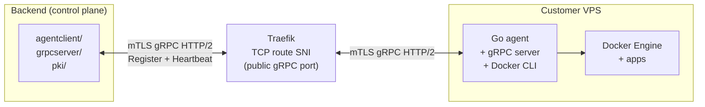
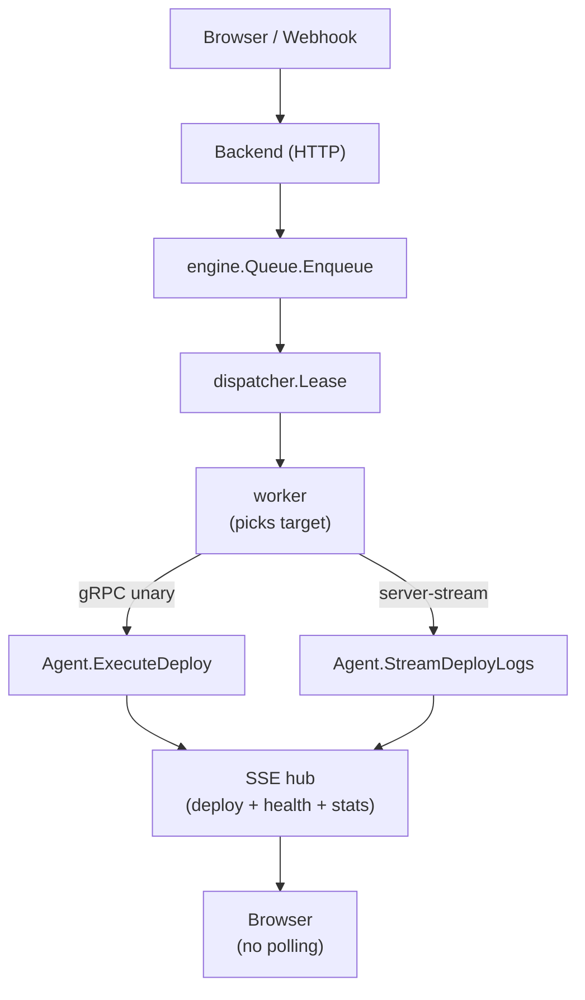

# Remote Deploy Architecture (gRPC Agent + mTLS)

This document describes how FlowDeploy runs deploys and commands on remote servers (VPSs) through a **lightweight Go agent** on each machine, controlled by the backend via **gRPC over mTLS**.

> For the operational walkthrough (register VPS, provision, debug) see [`REMOTE_SERVER_TUTORIAL.md`](./REMOTE_SERVER_TUTORIAL.md).
>
> For platform overview see [`ARCHITECTURE.md`](./ARCHITECTURE.md).

## 1. Why gRPC + mTLS

| Aspect          | REST / WebSocket                  | gRPC (FlowDeploy choice)            |
| --------------- | --------------------------------- | ----------------------------------- |
| Protocol        | JSON over HTTP                    | Binary Protobuf over HTTP/2        |
| Contract        | Documented separately             | Versioned `.proto` and codegen      |
| Streaming       | Separate WebSocket                | Native bidirectional (logs, exec)   |
| Typing          | Manual                            | Strong, generated for Go            |
| Authentication  | TLS + token                       | mTLS (mutual certificates)          |
| Cancellation    | Manual implementation             | End-to-end `context.Context`        |

The gRPC + mTLS combination handles agent authentication, backend authentication,
channel integrity, and fine-grained cancellation in a single layer (required
for long-lived streams such as `StreamDeployLogs` and `ExecContainer`).

## 2. Topology

- The backend runs two gRPC servers: an internal one (agent registration) and the
  client that calls the agent for operations (deploy, list containers, etc.).
- The agent runs **one** gRPC server and a client that only calls
  `Register` and `Heartbeat` on the backend.
- Traefik publishes the backend gRPC port via TCP route SNI, allowing
  reuse of the same public hostname (HTTPS for the dashboard + HTTP/2 for gRPC).

## 3. Components

### 3.1 Backend (`apps/backend/internal`)

| Package          | Responsibility                                                                                    |
| ---------------- | ------------------------------------------------------------------------------------------------- |
| `pki/`           | Internal certificate authority; issues and renews agent certificates                                |
| `grpcserver/`    | gRPC server for `Register` and `Heartbeat`; validates certificate against the CA                    |
| `agentclient/`   | gRPC client to call agents (deploy, containers, exec, images, networks, volumes, healthcheck)      |
| `agentdownload/` | Serves agent binaries for auto-update (`/internal/agent/download`)                                |
| `provisioner/`   | SSH provisioning: installs Docker, Traefik, agent, and enables the `systemd` unit                  |
| `engine/`        | Worker decides whether deploy runs locally (host) or remotely (via `agentclient`)                 |

### 3.2 Agent (`apps/agent/internal`)

| Package       | Responsibility                                                                  |
| ------------- | ------------------------------------------------------------------------------- |
| `agent/`      | Initializes config, registers with backend, maintains heartbeat                 |
| `grpcserver/` | gRPC server split by feature (containers, deploy, exec, images, ...)            |
| `deploy/`     | Deploy executor: clone repo, `docker build`, `compose up`, healthcheck          |
| `cleanup/`    | Periodic `docker prune` scheduler                                               |

### 3.3 Contract

The contract lives in `apps/proto/flowdeploy/v1/agent.proto` and is generated for Go
via `buf generate`. Summary of main RPCs:

| RPC                                 | Type               | Use                                       |
| ----------------------------------- | ------------------ | ----------------------------------------- |
| `Register`                          | unary              | Agent announces ID, version, and metadata |
| `Heartbeat`                         | unary              | Keep server `online` in the dashboard     |
| `ExecuteDeploy`                     | unary              | Backend triggers a new deploy             |
| `StreamDeployLogs`                  | server-streaming   | Backend subscribes to deploy logs in real time |
| `ListContainers` / `Get*` / `Stop*`| unary              | Container management operations           |
| `GetContainerLogs`                  | server-streaming   | Container logs in real time               |
| `GetContainerStats`                 | server-streaming   | CPU/memory/network in real time           |
| `ExecContainer`                     | bidirectional      | Interactive terminal (PTY via `creack/pty`) |
| `PushUpdate`                        | client-streaming   | Backend sends new agent binary            |
| `RunContainerHealthcheck`           | unary              | Force health check on a container         |
| `ConfigureContainerSSL`             | unary              | Apply TLS via Traefik for the container   |

> Changes to `.proto` are **breaking** if they remove or renumber fields.
> Always run `buf breaking --against '.git#branch=main'` before committing.

## 4. Security layer (mTLS)

1. On first startup the backend generates a CA key pair and certificate and
   stores them encrypted in the `pki_ca` table (migration `000014`).
2. When a VPS is registered and provisioned:
   - The backend generates a client key pair for the agent, signed by the CA.
   - The backend also generates the VPS server certificate.
   - Everything is sent over SSH during provisioning.
3. On each gRPC call:
   - The agent presents its client certificate.
   - The backend pins the CA and verifies `Common Name` against `server_id`.
   - The agent validates the backend certificate with the same CA.
4. Renewal: certificates have configurable validity; the backend re-issues and
   sends to the agent via `PushUpdate`/rotation script.

> No agent talks to another agent. All control is centralized in the
> backend (control plane).

## 5. Remote deploy lifecycle

Internal steps inside the agent (`apps/agent/internal/deploy`):

1. `git clone` (or `git fetch + checkout`) using the GitHub token provided by the
   backend.
2. Validate `paasdeploy.json` (including `workdir` for monorepos).
3. `docker compose build` (or `docker build` + `docker run`), always via
   `shared/pkg/executor` with explicit arguments.
4. `docker compose up -d` with Traefik labels generated by the backend (domains,
   path prefixes, certificates).
5. Health check based on `/health` or custom command; configurable retries.
6. On failure: `compose down` the new version + `compose up` the previous one
   (automatic rollback).
7. Final response to the backend via stream + update of the `deploys` table.

## 6. Agent auto-update

To avoid manual maintenance on each VPS:

1. Operator ships a new agent binary on the backend (updates `AGENT_VERSION` and
   builds).
2. Backend serves the binary via `agentdownload`.
3. When an agent sends `Heartbeat`, the backend compares versions; if an update
   is available, the backend calls `PushUpdate` (client-streaming) sending the
   binary in chunks.
4. Agent:
   - Receives chunks, validates hash, writes to a temp file.
   - Replaces the binary, rewrites the `systemd` unit if needed,
     restarts via `systemctl restart paasdeploy-agent`.
5. After restart, the agent reopens the gRPC connection and calls `Register` again with the new
   version.

Migration `000025_add_server_agent_update_mode` controls whether the server
accepts automatic auto-update or requires manual approval.

## 7. SSH provisioning

Summary of the flow executed by `internal/provisioner/ssh_provisioner.go`:

1. Connect via SSH (key generated by the backend or temporary password).
2. Validate and store `SSH_HOST_KEY` (TOFU + persistence in `servers.ssh_host_key`).
3. Detect privileges: run as `root` or use `sudo` with a temporary password.
4. Install Docker Engine + Compose v2 (idempotent: skip if already installed).
5. Create the Docker network `paasdeploy_net`.
6. Install Traefik on the VPS when `acme_email` is configured
   (each VPS manages its own TLS for apps running there).
7. Upload the agent binary to `~/paasdeploy-agent/`.
8. Create the `systemd` unit `paasdeploy-agent.service` with flags:
   `--server-addr`, `--server-id`, `--ca-cert`, `--cert`, `--key`, `--agent-port`.
9. Enable and start the service.
10. Verify the agent completed `Register` on the backend before signaling
    success to the UI.

## 8. Observability

- Structured logs (`log/slog`) on both backend and agent.
- The backend correlates logs with `serverId`, `deployId`, and `appId`.
- Stats via `GetSystemMetrics`/`GetContainerStats` feed the
  `server_stats_monitor` that emits SSE events to the dashboard.

## 9. Common failures and diagnosis

| Symptom                                        | Likely cause                                       | Where to look                       |
| ---------------------------------------------- | -------------------------------------------------- | ----------------------------------- |
| Server stuck in `provisioning`                 | Invalid SSH key or Docker unavailable              | backend logs (step `step=docker`)   |
| Agent never shows as `online`                  | gRPC port not published or Traefik missing TCP route | `traefik.yml`, `iptables`, firewall |
| `mTLS handshake failure`                       | Expired certificate or mismatched CA               | `pki_ca` table, regenerate cert     |
| Deploy fails at `git clone`                    | GitHub App token expired or wrong permissions      | `git_token_provider.go`, GitHub App |
| Healthcheck fails after build                  | App does not expose `/health` on mapped port       | `paasdeploy.json` + container logs  |
| `ExecContainer` disconnects                    | Intermediate proxy cuts HTTP/2 without ping        | proxy / Traefik configuration       |
| Auto-update fails                              | Permission on `/usr/local/bin/` or missing systemd   | agent logs, `systemctl status`      |

## 10. Design decisions

- **No distributed queue** — the backend is the single source of truth; agents do not
  talk to each other. This simplifies deploy/update and keeps audit
  centralized.
- **Strong idempotency** — `ExecuteDeploy` accepts the same `(app_id, sha)` more
  than once without side effects (already persisted in the DB with dedup).
- **Streams are first-class** — logs and exec use native streams; SSE only
  appears on the frontend, not on the agent protocol.
- **Zero external DB dependency on the agent** — the agent uses no database and no
  Redis. State lives in memory + `systemd` files.
- **Operations are the product** — provisioning, update, rollback, and cleanup
  are first-class features, not ad-hoc scripts.

## 11. Where to change when evolving

| Change                               | Files                                                                 |
| ------------------------------------ | --------------------------------------------------------------------- |
| New RPC                              | `apps/proto/flowdeploy/v1/agent.proto` + buf generate + impl in `apps/agent/internal/grpcserver` + call in `apps/backend/internal/agentclient` |
| New deploy step                      | `apps/agent/internal/deploy/` + update SSE event types                |
| mTLS / rotation change               | `apps/backend/internal/pki/` + provisioner                            |
| New provisioning step                | `apps/backend/internal/provisioner/ssh_provisioner.go`                |
| New dashboard event                  | add type in `internal/handler/sse_handler.go`                           |
